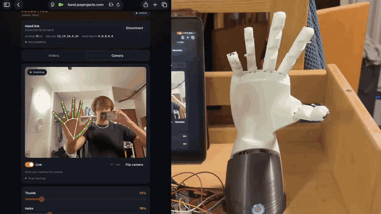
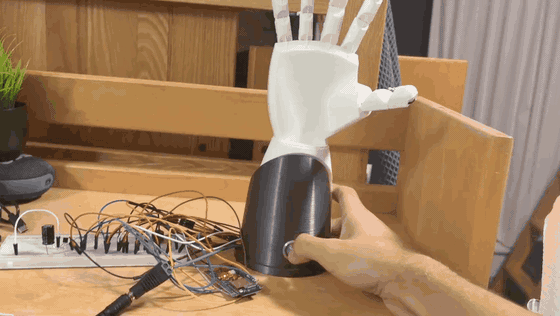
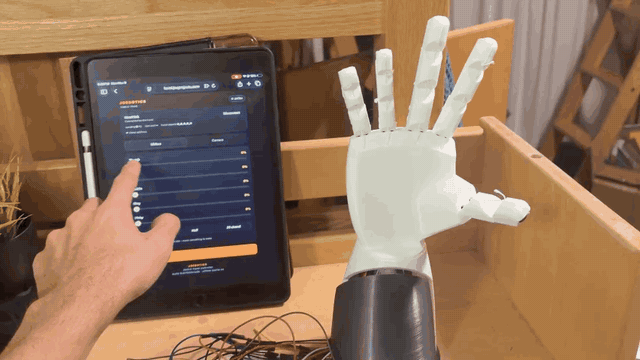
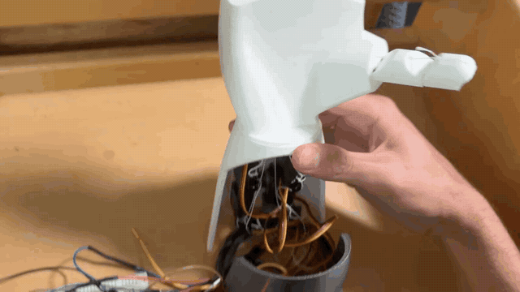
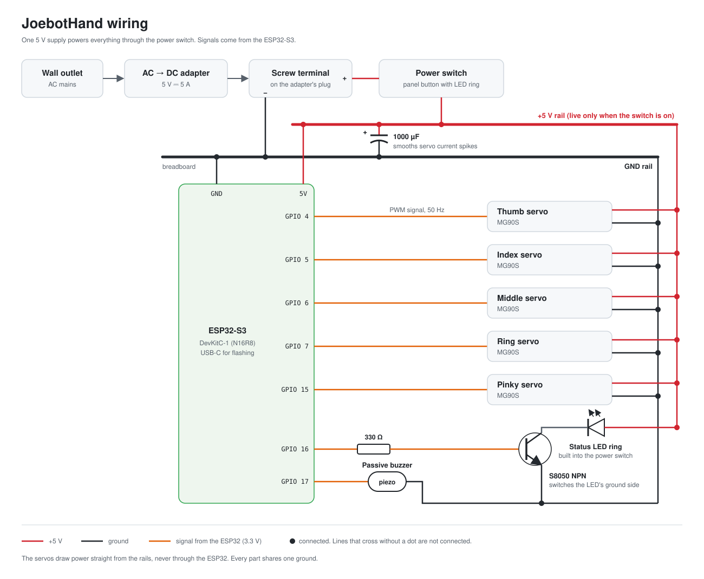

# JoebotHand

A 3D-printed, five-finger robotic hand that copies your hand in real time.
The hand's own web app tracks your fingers with MediaPipe and streams finger 
positions over Wi-Fi to an ESP32-S3, which drives
five servos that pull each finger closed. 

<p align="center">
  
</p>

> Full video: **TODO YouTube link**

## Highlights

- **Camera control, no glove:** finger curl is computed from 3D hand landmarks
  in the phone's browser, then smoothed and calibrated per finger.
- **The hand hosts its own app:** the ESP32-S3 runs a Wi-Fi hotspot and serves
  the web app over HTTPS, with live control over a secure WebSocket.
- **Works offline:** the ML model and app (~9 MB compressed) are stored in the
  ESP32's flash and cached on the phone.
- **Safe by default:** per-finger angle limits protect the servo gears, a
  watchdog opens the hand if the phone disconnects, and the servos go limp
  after a minute of no commands.
- **Feedback:** a buzzer for start-up and connection sounds, and a status light
  that breathes while waiting and stays solid while a phone is connected.

<table>
  <tr>
    <td width="50%"></td>
    <td width="50%"></td>
  </tr>
  <tr>
    <td align="center"><sub>Press the button: startup chirp and finger wave</sub></td>
    <td align="center"><sub>Manual control: one slider per finger</sub></td>
  </tr>
</table>

> **TODO (Joe):** still photos: finished hand, electronics close-up, phone app screenshot.

## How it works


1. **Tracking** (`web/index.html`): MediaPipe finds 21 points on your hand in
   3D. Each finger's curl is the sum of its joint bend angles, ignoring
   side-to-side spread, so it doesn't depend on how the hand is turned. Each
   finger is then mapped to 0–100% between calibrated "open" and "curled" poses.
2. **Link:** the phone joins the hand's Wi-Fi hotspot and opens the app the
   ESP32 serves. Browsers only allow the camera on secure (HTTPS) pages, so
   the ESP32 runs an HTTPS server with a real certificate, and the WebSocket
   runs on the same secure connection.
3. **Firmware** (`firmware/esp32_hand`): converts each percentage to a servo
   angle within that finger's limits and drives the servo with the ESP32's
   hardware PWM.

## Engineering challenges

> **TODO (Joe):** rewrite these in your own words. They're the most interesting part for a reader.

- **A servo library bug:** with the popular ESP32Servo library the fingers
  didn't move independently. Reading the chip's pin routing directly showed
  the library was sending several servos' signals to the same output. Replaced
  it with direct hardware PWM. Details in
  [`firmware/diagnostics`](firmware/diagnostics/README.md).
- **Camera vs. local network:** an HTTPS page can't talk to plain `ws://`, and
  a plain HTTP page can't use the camera. The fix was to serve everything from
  the ESP32 itself over TLS.
- **Fitting a neural network on a microcontroller's flash:** the app,
  MediaPipe's WebAssembly runtime and the model are gzipped into 75% of a
  12 MB partition and served with download progress.
- **Phones abandoning a network with no internet:** the ESP32 answers phones'
  "is there internet?" checks so they stay connected to the hand.
- **A quiet buzzer:** passive piezos are loudest near their resonance
  (~4 kHz), so the sounds were retuned there.

## Hardware

<p align="center">
  
  <br><sub>Inside the forearm: five servos pull a string for each finger</sub>
</p>

| Part | Notes |
| --- | --- |
| ESP32-S3 DevKitC-1 (N16R8) | 16 MB flash, 8 MB PSRAM |
| 5 × MG90S servos | thumb GPIO 4, index 5, middle 6, ring 7, pinky 15 |
| Separate 5 V supply | for the servos, ground shared with the ESP32 |
| Passive piezo buzzer | GPIO 17 |
| Panel button with LED ring | LED on GPIO 16 through an S8050 transistor |
| **TODO** | power supply rating, strings, screws, approximate total cost |

<p align="center">
  
</p>

> **TODO (Joe):** your CAD (STL + source) → `hardware/`.

## Credits and tools

- The hand and finger design, servo placement and string routing come from
  Viral Science's
  [Arduino flex-sensor robot hand tutorial](https://www.viralsciencecreativity.com/post/arduino-flex-sensor-controlled-robot-hand).
- **My additions:** a redesigned forearm with a button mount, an improved
  stand, the wiring, the port from Arduino to ESP32-S3, camera tracking in
  place of flex sensors, the self-hosted web app, and the buzzer and status light.
- Hand tracking uses Google's [MediaPipe](https://ai.google.dev/edge/mediapipe/solutions/vision/hand_landmarker).
- > **TODO (Joe):** your AI-assistance note, in your own words.

## Repository layout

| Path | What's there |
| --- | --- |
| [`firmware/esp32_hand`](firmware/esp32_hand) | Main ESP32-S3 firmware, plus scripts to build certificates and flash the web app |
| [`web`](web) | The phone app the hand serves (tracking, sliders, presets) |
| [`tracking`](tracking) | Desktop browser harness used to develop and tune the curl math |
| [`firmware/diagnostics`](firmware/diagnostics) | Bring-up and debugging sketches |
| [`firmware/uno_hand_v1`](firmware/uno_hand_v1) | Version 1: Arduino Uno over USB serial |
| [`desktop`](desktop) | Python control panels from version 1, and a USB test tool for the ESP32 |

## Building it

Uses [arduino-cli](https://arduino.github.io/arduino-cli/) with the ESP32 core 3.3.

```bash
tracking/fetch_vendor.sh                                    # MediaPipe + model, once
cp firmware/esp32_hand/wifi_secrets.example.h firmware/esp32_hand/wifi_secrets.h   # set a password
firmware/esp32_hand/make_certs.sh                           # TLS certificates
arduino-cli compile --upload -p <port> \
  --fqbn esp32:esp32:esp32s3:PSRAM=opi,FlashSize=16M,CDCOnBoot=cdc,PartitionScheme=fatflash \
  firmware/esp32_hand
firmware/esp32_hand/upload_fs.sh <port>                     # flash the web app
```

Then join the `JOES-HAND` Wi-Fi on your phone and open the hand's address.

## License

[MIT](LICENSE). The tutorial's hand design is not included here; see the link above.
