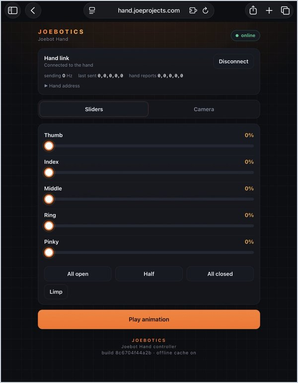
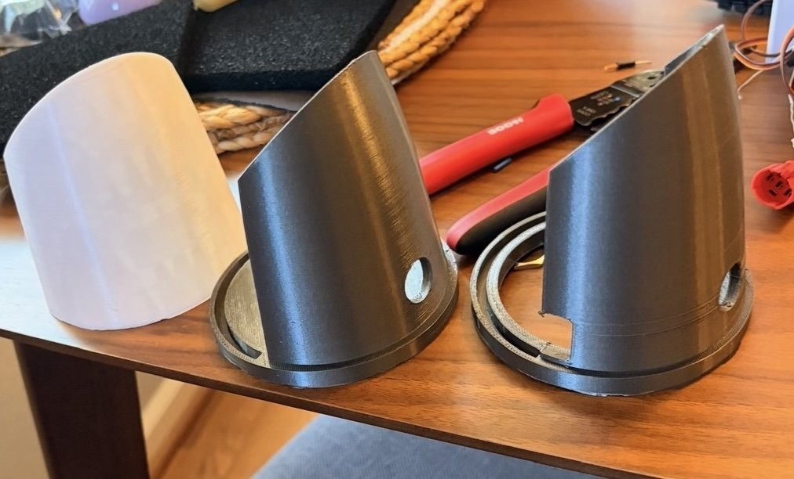
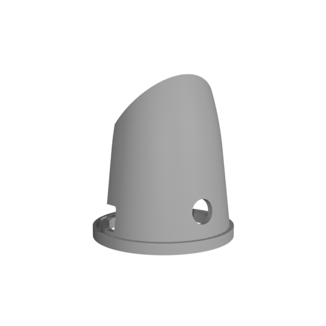

# JoebotHand

A 3D-printed, five-finger robotic hand that copies your hand in real time.
The hand's own web app tracks your fingers with MediaPipe and streams finger 
positions over Wi-Fi to an ESP32-S3, which drives
five servos that pull each finger closed. 

<p align="center">
  
</p>

<p align="center">
  <a href="https://youtu.be/8RsPFerTg4E">▶ Watch the full demo on YouTube</a>
</p>

## Highlights

- **Camera control:** finger curl is computed from 3D hand landmarks
  in the phone's browser, then smoothed and calibrated per finger.
- **The hand hosts its own app:** the ESP32-S3 runs a Wi-Fi hotspot and serves
  the web app over HTTPS, with live control over a secure WebSocket.
- **Works offline:** the ML model and app (~9 MB compressed) are stored in the
  ESP32's flash and cached on the phone.
- **Safe by default:** per-finger angle limits protect the servo gears, a
  watchdog opens the hand if the phone disconnects, and the servos go limp
  after a minute of no commands.
- **Feedback:** a buzzer for start-up and connection sounds, and a status light
  that pulses while waiting and stays solid while a phone is connected.

<table>
  <tr>
    <td width="50%"></td>
    <td width="50%"></td>
  </tr>
  <tr>
    <td align="center"><sub>Press the button: startup chirp and finger wave</sub></td>
    <td align="center"><sub>Manual control: one slider per finger</sub></td>
  </tr>
</table>

## How it works




1. **Tracking** (`web/index.html`): MediaPipe finds 21 points on your hand in
   3D. Each finger's curl is the sum of its joint bend angles, ignoring
   side-to-side spread, so it doesn't depend on how the hand is turned. Each
   finger is then mapped to 0–100% between calibrated "open" and "curled" poses.
2. **Link:** the phone joins the hand's Wi-Fi hotspot and opens the app the
   ESP32 serves. Browsers only allow the camera on secure (HTTPS) pages, so
   the ESP32 runs an HTTPS server with a real certificate, and the WebSocket
   runs on the same secure connection.
3. **Firmware** (`firmware/esp32_hand`): converts each percentage to a servo
   angle within that finger's limits and drives the servo with the ESP32's
   hardware PWM.

## Engineering challenges

- **A servo library bug:** with the ESP32Servo library the fingers
  didn't move independently, and attempting to move one finger moved many. 
  Reading the chip's pin routing directly showed the library was sending 
  several servos' signals to the same output. Replaced it with direct 
  hardware PWM. Details in
  [`firmware/diagnostics`](firmware/diagnostics/README.md).
- **Camera vs. local network:** browsers only allow the camera on secure
  (HTTPS) pages, but a secure page can't talk to an insecure device like the
  hand. Hosting the app online failed because of that, so the ESP32
  now serves the app itself over HTTPS, using a real certificate for my own
  domain (`hand.joeprojects.com`) that points to the hand's local address.
  Phones open it with no security warning, even with no internet.
- **Fitting a neural network on a microcontroller's flash:** the app,
  MediaPipe's WebAssembly runtime and the model are gzipped into 75% of a
  12 MB partition and served with download progress.

## Hardware

<p align="center">
  
  <br><sub>Inside the forearm: five servos pull a string for each finger</sub>
</p>

| Part | Notes |
| --- | --- |
| ESP32-S3 DevKitC-1 (N16R8) | 16 MB flash, 8 MB PSRAM |
| 5 × MG90S servos | thumb GPIO 4, index 5, middle 6, ring 7, pinky 15 |
| 5 V 5 A AC-to-DC adapter | 5.5 × 2.5 mm barrel plug into a screw-terminal adapter; powers the servos and the ESP32 through the power switch |
| Passive piezo buzzer | GPIO 17 |
| Panel button with LED ring | latching power switch; LED on GPIO 16 through an S8050 transistor |
| Breadboard and passives | 1000 µF capacitor across the supply, 330 Ω resistor, jumper wires |
| Braided fishing line | the tendons: each servo pulls its finger closed |
| 2 mm elastic cord | runs through the fingers and springs them back open |

About $80 in parts, plus the 3D-printing filament.

<p align="center">
  
  <br><sub>Wiring schematic</sub>
</p>

### Forearm and stand iterations

<p align="center">
  
</p>

1. **Original:** the plain forearm from the tutorial design.
2. **Version 2:** my first redesign. A solid round base so the hand stands on its
   own, a press fit so the hand slides on and off easily, and a hole for the
   power button.
3. **Version 3 (current):** the base is hollowed out (still round) so the
   servos have their full range of motion, with holes for the wires to exit
   and corrected dimensions.

<p align="center">
  
  <br><sub><a href="hardware/forearm_v3.stl">Version 3 forearm and stand (STL)</a></sub>
</p>

## Credits and tools

- The hand and finger design, servo placement and string routing come from
  Viral Science's
  [Arduino flex-sensor robot hand tutorial](https://www.viralsciencecreativity.com/post/arduino-flex-sensor-controlled-robot-hand).
- **My additions:** a redesigned forearm with a button mount, an improved
  stand, the wiring, the change from Arduino to ESP32-S3, camera tracking in
  place of flex sensors, the self-hosted web app, and the buzzer and status light.
- Hand tracking uses Google's [MediaPipe](https://ai.google.dev/edge/mediapipe/solutions/vision/hand_landmarker).
- Assisted by Claude Code for development, refactoring, and debugging.

## Repository layout

| Path | What's there |
| --- | --- |
| [`firmware/esp32_hand`](firmware/esp32_hand) | Main ESP32-S3 firmware, plus scripts to build certificates and flash the web app |
| [`web`](web) | The phone app the hand serves (tracking, sliders, presets) |
| [`tracking`](tracking) | Desktop browser harness used to develop and tune the curl math |
| [`firmware/diagnostics`](firmware/diagnostics) | Bring-up and debugging sketches |
| [`firmware/uno_hand_v1`](firmware/uno_hand_v1) | Version 1: Arduino Uno over USB serial |
| [`desktop`](desktop) | Python control panels from version 1, and a USB test tool for the ESP32 |
| [`hardware`](hardware) | STL of my forearm and stand (version 3) |

## Building it

Uses [arduino-cli](https://arduino.github.io/arduino-cli/) with the ESP32 core 3.3.

```bash
tracking/fetch_vendor.sh                                    # MediaPipe + model, once
cp firmware/esp32_hand/wifi_secrets.example.h firmware/esp32_hand/wifi_secrets.h   # set a password
firmware/esp32_hand/make_certs.sh                           # TLS certificates
arduino-cli compile --upload -p <port> \
  --fqbn esp32:esp32:esp32s3:PSRAM=opi,FlashSize=16M,CDCOnBoot=cdc,PartitionScheme=fatflash \
  firmware/esp32_hand
firmware/esp32_hand/upload_fs.sh <port>                     # flash the web app
```

Then join the `JOES-HAND` Wi-Fi on your phone and open the hand's address.

## License

[MIT](LICENSE)